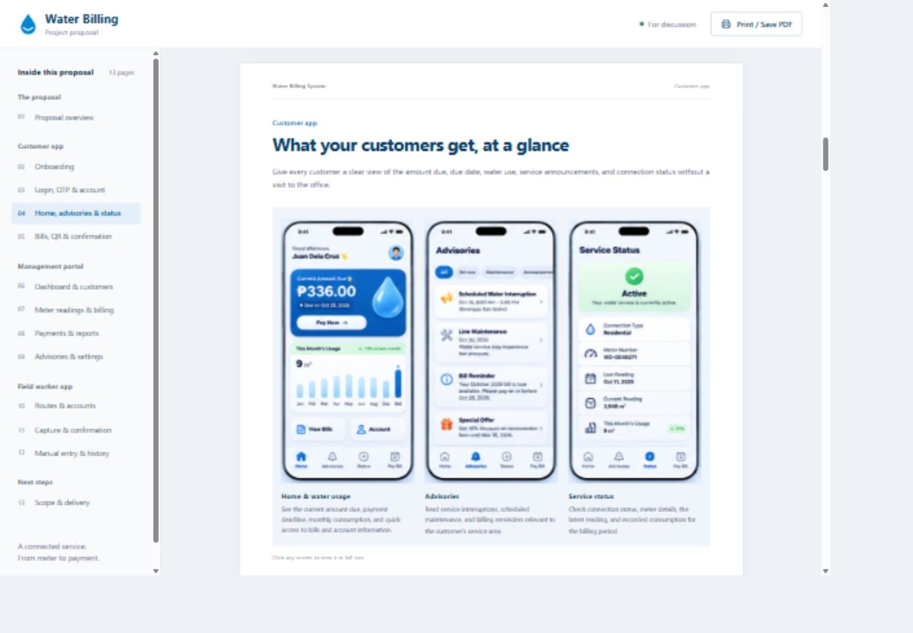

# Water Billing System — Visual Proposal

A Next.js website that reads like a document: white pages, a navigable table of contents, explained interface screenshots, and a print-friendly A4 layout.

The proposal brings together three experiences: a **customer mobile app**, a **water district management portal**, and a **field worker app** for meter reading.



## What is included

- **13 document pages** covering the proposed experience and implementation decisions.
- **Customer journey:** onboarding, login, OTP, account creation, home, advisories, service status, bill review, QR payment, and payment confirmation.
- **Staff portal:** dashboard, customers, meter readings, billing, payments, reports, advisories, and settings.
- **Field worker journey:** assigned routes, account selection, meter photo capture, reading review, confirmation, manual entry, and submission history.
- **28 screen images:** 12 customer screens, 8 worker screens, and 8 web views. Mobile screens are individually cropped from the supplied design sheets.
- Up to three mobile screenshots per row on desktop, with responsive presentation on smaller displays.
- Click-to-enlarge image dialogs with zoom, keyboard focus containment, Escape-to-close, and focus restoration through native HTML dialogs.
- Section navigation, current-page indication, and a compact contents menu on smaller screens.
- A **Print / Save PDF** action and A4 print styles that hide the website controls.

## Project status

This repository implements the **proposal website**. The displayed interfaces are supplied design references with illustrative data. It does not operate customer accounts, send OTPs, read meters, process payments, or connect to an existing billing database.

Payment provider integration, official receipt posting, account ownership verification, rates, database schemas, and staff permissions require confirmation before the operational platform is implemented. OCR and offline synchronization shown in the worker references are explicitly identified as proposed capabilities.

No API keys, credentials, database migrations, or environment variables are needed to run this document website.

## Run locally

Use **Node.js 24 or newer** and npm.

```bash
npm ci
npm run dev
```

Open [the local proposal](http://127.0.0.1:3117).

```bash
npm run typecheck
npm run build
npm run preview
```

`build` produces a static website in `out/`. `preview` serves that production export at the same local address; stop the development server first because both use port 3117. This export can be hosted on any service that supports Next.js static exports. It does not need a Node.js server in production.

## Edit the proposal

| File                                | Purpose                                                             |
| ----------------------------------- | ------------------------------------------------------------------- |
| `src/lib/proposal.ts`               | Section text, screenshot titles, descriptions, and proposal notes   |
| `src/app/page.tsx`                  | Document cover, page composition, and scope/delivery page           |
| `src/app/globals.css`               | Document layout, responsive styling, image viewer, and print styles |
| `src/components/document-shell.tsx` | Contents navigation and print action                                |
| `src/components/image-viewer.tsx`   | Accessible image dialogs and zoom                                   |
| `asset/`                            | Original supplied design sheets and web references                  |
| `public/screens/`                   | Optimized WebP screenshots used by the website                      |
| `scripts/prepare-assets.ts`         | Reproducible screenshot extraction and optimization                 |
| `docs/proposal-preview.jpg`         | Actual browser screenshot used above                                |

After changing source artwork or crop boundaries, run:

```bash
npm run assets
npm run build
```

Crop coordinates are specific to the supplied source sheets. Update those coordinates if the source dimensions or screen arrangement change. Optimized screen assets are included in Git, so asset regeneration is not required for normal installation.

## Printing

Select **Print / Save PDF**, choose **A4**, use **100% scale**, and turn off the browser's headers and footers. Enable background graphics to retain the blue image panels and notes. Desktop Chrome or Edge is recommended for reviewing the final output. Printing uses the browser's native dialog; confirm pagination in that browser before sharing a PDF.

## Repository connection

The local `origin` remote is configured for [rcconstante/water-billing](https://github.com/rcconstante/water-billing). No push has been performed.

When ready to publish the source yourself:

```bash
git add .
git commit -m "Build document-style water billing proposal"
git push -u origin main
```

If using a separate clone, add the remote only if one is not already configured:

```bash
git remote add origin https://github.com/rcconstante/water-billing.git
```

Review the supplied design assets and proposal text before publishing. The screenshots are reference artwork, and the proposed product still requires its own approved scope and implementation.

## Validation

- Production build and strict TypeScript checks.
- Desktop and narrow-screen browser review.
- Mobile contents navigation and section selection.
- Image fullscreen opening, zoom state, Escape and close-button behavior.
- Screen asset loading and document-width checks.

The browser's native print output should be reviewed manually; this repository does not include a generated PDF or claim that payment/backend functionality is implemented.
